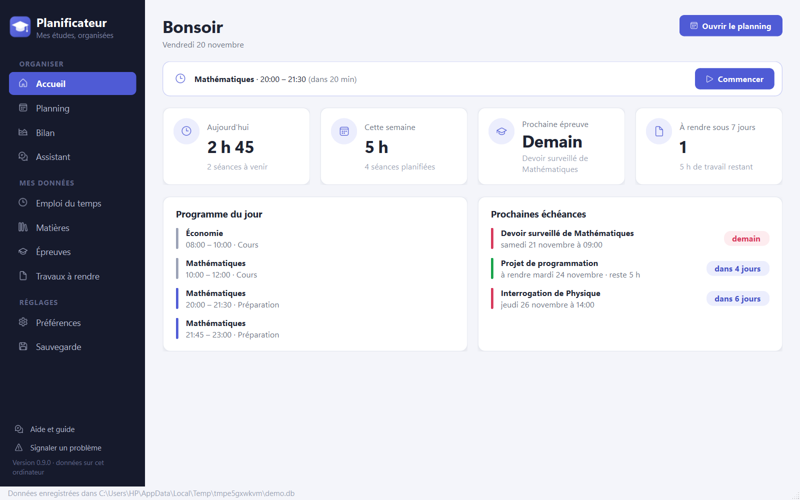
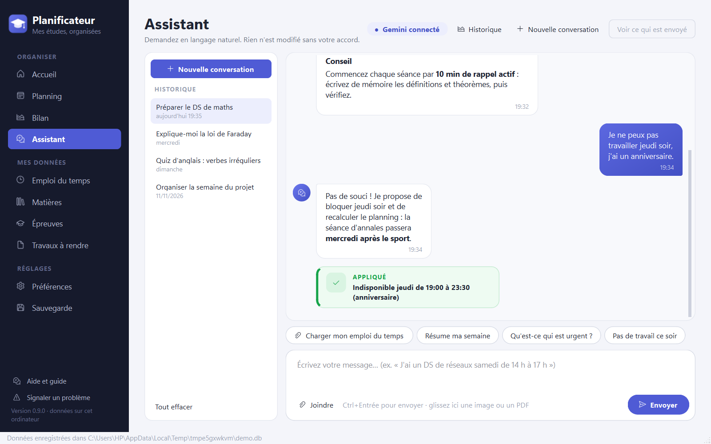
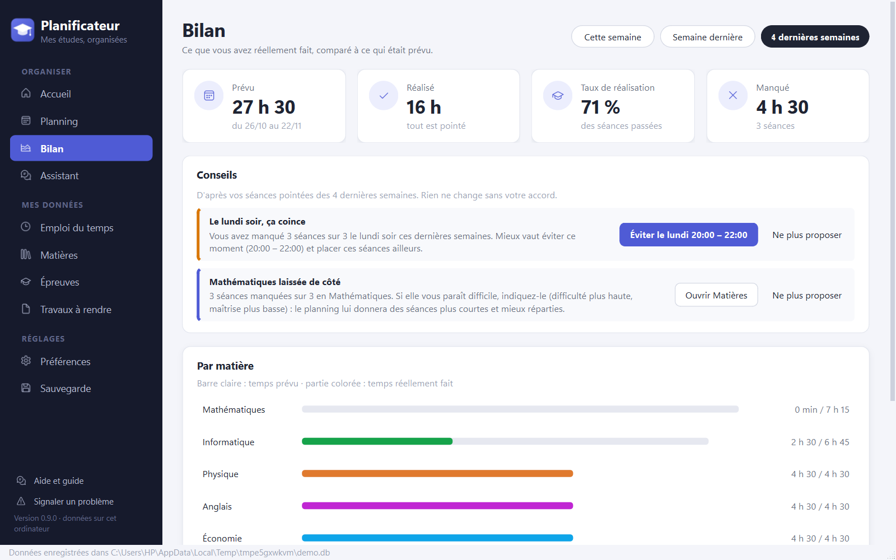

# Planificateur d'études

[](../../releases/latest)

[](LICENSE)

**Une application Windows gratuite qui transforme votre emploi du temps, vos épreuves et vos travaux à rendre en un planning de révision réaliste, semaine après semaine.**

Vous saisissez vos cours, vos épreuves et vos devoirs. L'application place vos séances de révision dans vos moments libres, en respectant votre rythme. Elle s'adapte quand vous manquez une séance, et vous dit honnêtement quand tout ne tient pas. Vos données restent sur votre ordinateur.


**[⬇ Télécharger la dernière version](../../releases/latest)** · gratuit, en français, sans compte ni publicité

---

## Ce qu'elle fait

### Organiser
- **Planning automatique** : les préparations d'épreuves et les travaux sont placés avant leur échéance et étalés sur plusieurs jours. Les cours se révisent de préférence la veille ou l'avant-veille.
- **Respect de votre rythme** : heures de lever et de coucher, repas, pauses, jours particuliers, moments préférés ou à éviter, soirées de travail garanties. Tout se règle.
- **Honnêteté** : si tout ne tient pas, l'application indique le temps manquant au lieu de surcharger vos journées.
- **Emploi du temps en grille** : cliquez-glissez pour ajouter un cours, glissez pour le déplacer.

### Suivre
- **Minuteur de séance** : un clic sur *Commencer* lance un minuteur discret. Il propose une pause toutes les 25 minutes, puis pointe la séance tout seul avec le temps réellement travaillé.
- **Bilan et conseils** : ce qui était prévu et ce qui a été fait, par matière. L'application repère aussi les créneaux souvent manqués ou les séances trop longues, et propose le bon réglage.
- **Rappels** : une notification Windows avant chaque séance, la veille d'une épreuve et avant un travail à rendre.

### Assistant IA (facultatif)
- Posez vos questions en langage naturel, par exemple « Je ne peux pas travailler ce soir » ou « J'ai un DS samedi à 14 h ».
- Demandez de l'aide pour vos cours : explication d'une notion, méthode de révision, petit quiz.
- **Joignez une photo ou un PDF** de votre emploi du temps ou de votre calendrier d'examens : l'assistant le lit, et vous vérifiez chaque ligne avant l'ajout.
- Vos conversations restent dans un **historique**, comme dans les applications de discussion, sur votre ordinateur.
- **Rien n'est modifié sans votre accord.**

### Partager et protéger
- **Export vers votre agenda** (Google Agenda, Outlook, téléphone), **PDF du planning** et **liste des épreuves à imprimer**.
- **Sauvegardes** : une copie par jour sur l'ordinateur, plus une copie automatique vers une clé USB ou OneDrive.
- **Mises à jour annoncées** dans l'application ; vous installez la nouvelle version par-dessus et vos données sont conservées.
- **Raccourcis clavier** et **guide intégré** (touche F1).

| Accueil | Assistant | Bilan |
|---|---|---|
|  |  |  |

## Installer

**Il faut** Windows 10 ou 11 (64 bits). Ni Python, ni droits administrateur, ni Internet ne sont nécessaires.

1. Téléchargez **`Installer-PlanificateurEtudes-x.y.z.exe`** depuis la page [**Releases**](../../releases/latest).
2. Lancez-le. Windows affichera probablement « Windows a protégé votre ordinateur », car l'installateur n'est pas signé par un certificat payant. Cliquez sur **Informations complémentaires**, puis sur **Exécuter quand même**.
3. Suivez l'assistant d'installation, en français. L'application s'installe pour votre compte uniquement, avec un raccourci dans le menu Démarrer.

Au premier lancement, un accueil en 3 étapes règle vos horaires, vos matières et la saisie de l'emploi du temps. Le **guide intégré** (*Aide et guide* en bas du menu, ou F1) explique tout le reste.

## Questions fréquentes

**Est-ce vraiment gratuit ?**
Oui. Le code est libre (licence MIT), sans compte, sans publicité et sans abonnement. L'assistant IA utilise votre propre clé Gemini, gratuite à créer sur [Google AI Studio](https://aistudio.google.com/apikey).

**Où sont mes données ?**
Elles sont uniquement sur votre ordinateur, dans `%APPDATA%\PlanificateurEtudes\donnees.db`. Internet ne sert qu'à deux choses :
- l'assistant IA, si vous ajoutez une clé ;
- une vérification par jour du numéro de la dernière version, désactivable dans *Préférences › Nouvelles versions*.

Quand vous utilisez l'assistant, seuls votre message, les données utiles du planificateur et le fichier joint sont envoyés à Google. Le bouton *Voir ce qui est envoyé* montre le dernier échange.

**Comment mettre à jour ?**
L'application annonce les nouvelles versions sur l'Accueil. Téléchargez-la et installez-la par-dessus : vos données sont conservées. Une désinstallation ne les efface pas non plus.

**Et sur Mac, Linux ou téléphone ?**
L'application est faite pour Windows. Pour voir votre planning sur votre téléphone, utilisez l'export vers votre agenda.

**Un problème, une idée ?**
Cliquez sur **Signaler un problème** en bas du menu, ou ouvrez la page [Issues](../../issues/new/choose). Un formulaire simple, en français, vous guide.

## Règles de planification

- Les cours, activités fixes et épreuves ne sont jamais déplacés.
- Les échéances les plus proches passent d'abord, au plus une séance par jour pour une même épreuve ou un même travail, étalées sur les jours qui précèdent.
- Aucune séance pendant les pauses et les repas, ni dans les 3 h avant une épreuve, ni après elle le même jour ; 2 h au plus le jour d'une épreuve.
- Les plages garanties (par défaut 20 h – 23 h du lundi au vendredi) sont toujours remplies. Les autres moments libres de la semaine reçoivent des séances espacées, dans la limite du jour.
- Les révisions de cours se placent de préférence la veille ou l'avant-veille du cours. Elles sont réparties selon coefficient × difficulté × (6 − maîtrise). Une matière terminée n'est plus révisée.
- Les séances faites, déplacées à la main ou verrouillées ne sont jamais modifiées par un recalcul.

Tous ces réglages se changent dans l'écran Préférences.

## Pour les développeurs

Il faut Python 3.12 ou plus récent.

```bash
py -3.12 -m venv .venv
```

```bash
.venv/Scripts/python.exe -m pip install -e .[dev]
```

Lancer depuis le code (ou double-cliquer sur `Lancer.bat`) :

```bash
.venv/Scripts/python.exe -m planificateur
```

Lancer les tests :

```bash
.venv/Scripts/python.exe -m pytest -q
```

Construire l'installateur. Le script lance les tests, construit l'application autonome avec PyInstaller, fait l'auto-test de l'exécutable, puis lance Inno Setup 6 (`winget install JRSoftware.InnoSetup`) :

```bash
powershell -ExecutionPolicy Bypass -File packaging/construire.ps1
```

Le résultat est dans `build\installateur\`. Pour une nouvelle version, changez le numéro dans `pyproject.toml`, `planificateur/__init__.py`, `packaging/version.txt` et `packaging/installateur.iss`.

| Dossier / fichier | Rôle |
|---|---|
| `planificateur/modeles.py` | Données : matières, activités fixes, épreuves, travaux, séances, préférences |
| `planificateur/base.py` | Stockage SQLite, migrations, sauvegarde et restauration vérifiées |
| `planificateur/moteur/` | Moteur de planification, indépendant de l'interface : créneaux libres et placement |
| `planificateur/suivi.py`, `conseils.py`, `minuteur.py` | Pointage, bilan, conseils et minuteur de séance |
| `planificateur/ia/` | Assistant IA facultatif : client Gemini, clé chiffrée, lecture de documents, mise en forme |
| `planificateur/mises_a_jour.py` | Vérification de la dernière version. Avec `ia/gemini.py`, c'est le seul code qui accède au réseau (vérifié par un test). |
| `planificateur/ui/` | Interface PySide6 |
| `packaging/` | Icône, recette PyInstaller, script Inno Setup, script de construction |
| `tests/` | Tests du moteur, des scénarios du cahier des charges, de l'IA (réponses simulées) et de l'interface |

## Licence

Code sous licence [MIT](LICENSE). Pour les composants tiers (Qt / PySide6 sous LGPL v3, Python, PyInstaller, Inno Setup), voir [MENTIONS-LEGALES.md](MENTIONS-LEGALES.md).
