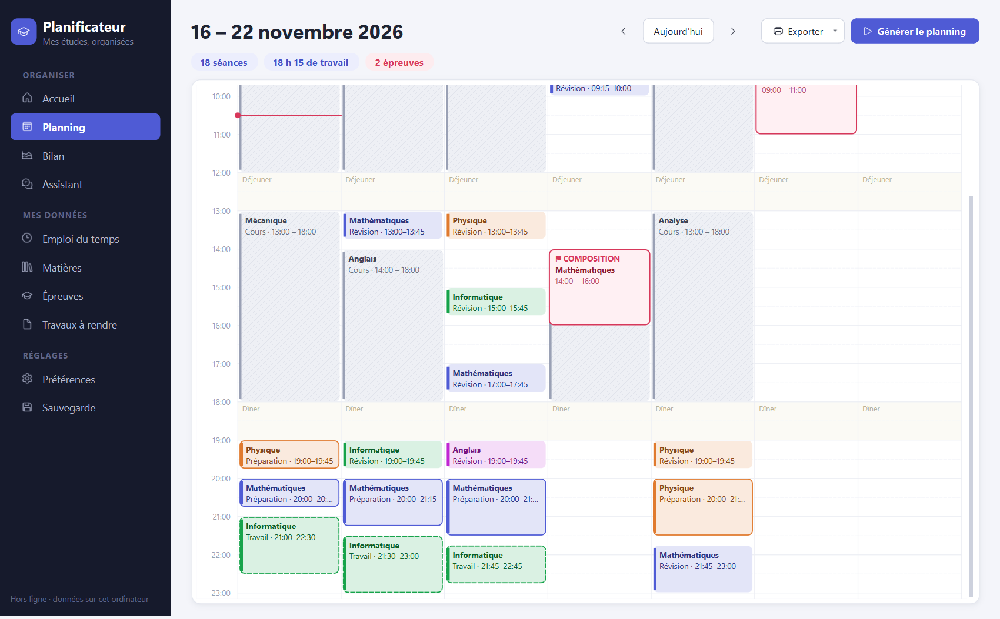
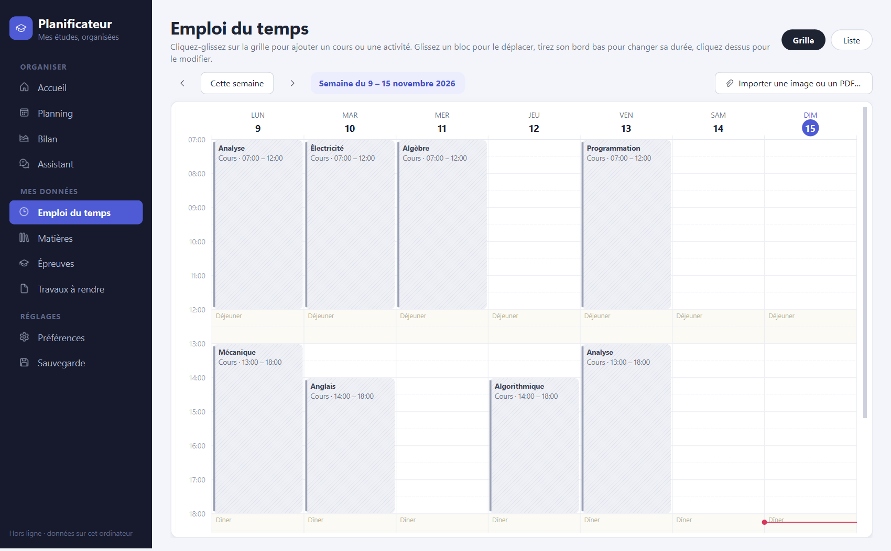

# Planificateur d'études

Application Windows gratuite qui transforme votre emploi du temps, vos épreuves et vos travaux à rendre en un **planning de révision réaliste**, semaine après semaine. Elle fonctionne **entièrement hors ligne** : vos données restent sur votre ordinateur.



## Ce qu'elle fait

- **Planning automatique** : les préparations d'épreuves et les travaux sont placés avant leur échéance, étalés sur plusieurs jours ; les cours se révisent de préférence la veille ou l'avant-veille.
- **Respecte votre rythme** : heures de lever et de coucher, repas, pauses, jours particuliers, moments préférés ou à éviter, soirées de travail garanties (réglables).
- **Honnête** : si tout ne tient pas, elle le dit, avec le temps manquant, au lieu de surcharger vos journées.
- **Suivi** : vous pointez chaque séance (faite, en partie, manquée) ; une séance manquée est replanifiée ; un bilan montre ce qui a été réellement fait.
- **Emploi du temps en grille** : cliquer-glisser pour ajouter un cours, glisser pour le déplacer.
- **Rappels** : notification Windows avant chaque séance, la veille d'une épreuve, avant un travail à rendre, et un point du soir. L'application peut rester discrètement près de l'horloge et démarrer avec Windows (réglable, hors ligne).
- **Export PDF** du planning de la semaine, **sauvegardes** automatiques et restauration vérifiée.
- **Assistant IA facultatif** (Gemini, avec votre propre clé gratuite) : questions en langage naturel, imprévus, et lecture d'un emploi du temps en image ou PDF. Rien n'est modifié sans votre accord.

| Accueil | Emploi du temps | Assistant |
|---|---|---|
|  |  |  |

## Télécharger et installer

**Configuration requise :** Windows 10 ou 11, 64 bits. Ni Python, ni droits administrateur, ni Internet ne sont nécessaires.

1. Téléchargez le fichier **`Installer-PlanificateurEtudes-x.y.z.exe`** dans la page [**Releases**](../../releases/latest).
2. Lancez-le. Windows affichera probablement **« Windows a protégé votre ordinateur »** : l'installateur n'est pas signé par un certificat payant. Cliquez sur **« Informations complémentaires »**, puis **« Exécuter quand même »**.
3. Suivez l'assistant d'installation (en français). L'application s'installe pour votre compte uniquement, avec un raccourci dans le menu Démarrer.

Pour désinstaller : *Paramètres > Applications > Planificateur d'études*. Vos données ne sont jamais effacées, ni par une désinstallation ni par une mise à jour (pour mettre à jour, il suffit d'installer la nouvelle version par-dessus).

## Premiers pas

Au premier lancement, un court assistant de bienvenue (3 étapes) règle vos horaires, vos matières et la saisie de l'emploi du temps. Ensuite :

1. **Matières** : ajoutez vos matières, avec leur coefficient, la difficulté ressentie et votre maîtrise.
2. **Emploi du temps** : cliquez-glissez sur la grille pour ajouter vos cours (ou importez une image / un PDF avec l'assistant IA).
3. **Épreuves** et **Travaux à rendre** : ajoutez ce qui arrive.
4. **Planning** : cliquez sur **Générer le planning**. Ajustez si besoin à la souris, puis pointez vos séances au fil des jours.
5. **Préférences** : adaptez les horaires, pauses, plages et limites à votre rythme. Les valeurs par défaut (lever 7 h, coucher 23 h, soirées de travail garanties de 20 h à 23 h du lundi au vendredi) ne sont qu'un point de départ.

Les données sont enregistrées dans `%APPDATA%\PlanificateurEtudes\donnees.db`, avec une copie automatique par jour (les 10 dernières sont gardées).

## Assistant IA (facultatif)

Avec une clé Gemini gratuite (à créer sur [Google AI Studio](https://aistudio.google.com/apikey), puis à saisir dans *Préférences > Assistant IA*) :

- **Assistant** : questions sur le planning, résumé de la semaine, imprévus en langage naturel (« je ne peux pas travailler ce soir », « j'ai un DS samedi à 14 h »). Chaque changement proposé s'applique seulement si vous cliquez sur *Appliquer*.
- **Lecture d'un emploi du temps** en image ou en PDF (depuis l'Assistant ou l'écran Emploi du temps) : Gemini propose les cours, que vous vérifiez et corrigez avant tout ajout.

**Confidentialité :** la clé est chiffrée pour votre compte Windows. Quand vous utilisez ces fonctions, seuls votre message, les données utiles du planificateur et le fichier joint sont envoyés à Google (`generativelanguage.googleapis.com`), avec la demande de ne pas les conserver ; le bouton *Voir ce qui est envoyé* montre le dernier échange. Les conditions de l'offre gratuite de Google s'appliquent. Sans clé, l'application reste entièrement hors ligne.

## Règles de planification

- Les cours, activités fixes et épreuves ne sont jamais déplacés.
- Les échéances les plus proches sont servies d'abord, au plus une fois par jour pour une même épreuve ou un même travail, étalées sur les jours qui précèdent.
- Aucune séance pendant les pauses et repas, ni dans les 3 h avant une épreuve, ni après elle le même jour ; 2 h au plus le jour d'une épreuve.
- Les plages garanties (par défaut 20 h – 23 h du lundi au vendredi) sont toujours remplies ; les autres moments libres de la semaine reçoivent des séances espacées, sans entasser, dans la limite du jour.
- Les révisions de cours se placent de préférence la veille ou l'avant-veille du cours, réparties selon coefficient × difficulté × (6 − maîtrise) ; une matière marquée terminée n'est plus révisée.
- Ce qui ne tient pas est signalé avec le temps manquant.
- Les séances faites, déplacées à la main ou verrouillées ne sont jamais modifiées par un recalcul.

Tous ces réglages se changent dans l'écran Préférences.

## Un problème, une idée ?

Cliquez sur **Signaler un problème** en bas du menu de l'application, ou ouvrez directement la page [Issues](../../issues/new/choose). Un formulaire simple (en français) vous guide.

## Pour les développeurs

Il faut Python 3.12 ou plus récent.

```bash
py -3.12 -m venv .venv
```

```bash
.venv/Scripts/python.exe -m pip install -e .[dev]
```

Lancer depuis le code (ou double-cliquer sur `Lancer.bat`) :

```bash
.venv/Scripts/python.exe -m planificateur
```

Lancer les tests :

```bash
.venv/Scripts/python.exe -m pytest -q
```

Construire l'installateur (tests, application autonome PyInstaller, auto-test de l'exécutable, puis Inno Setup 6 : `winget install JRSoftware.InnoSetup`) :

```bash
powershell -ExecutionPolicy Bypass -File packaging/construire.ps1
```

Le résultat est dans `build\installateur\`. Pour une nouvelle version, changer le numéro dans `pyproject.toml`, `planificateur/__init__.py`, `packaging/version.txt` et `packaging/installateur.iss`.

| Dossier / fichier | Rôle |
|---|---|
| `planificateur/modeles.py` | Données : matières, activités fixes, épreuves, travaux, séances, préférences |
| `planificateur/base.py` | Stockage SQLite, migrations, sauvegarde et restauration vérifiées |
| `planificateur/moteur/` | Moteur de planification, indépendant de l'interface : créneaux libres et placement |
| `planificateur/suivi.py` | Pointage des séances, temps restant, bilan |
| `planificateur/ia/` | Assistant IA facultatif (client Gemini, clé chiffrée, import d'emploi du temps) — seul code autorisé à accéder au réseau |
| `planificateur/ui/` | Interface PySide6 |
| `packaging/` | Icône, recette PyInstaller, script Inno Setup, script de construction |
| `tests/` | Tests du moteur, des scénarios du cahier des charges, de l'IA (réponses simulées) et de l'interface |

## Licence

Code sous licence [MIT](LICENSE). Composants tiers (Qt / PySide6 sous LGPL v3, Python, PyInstaller, Inno Setup) : voir [MENTIONS-LEGALES.md](MENTIONS-LEGALES.md).
